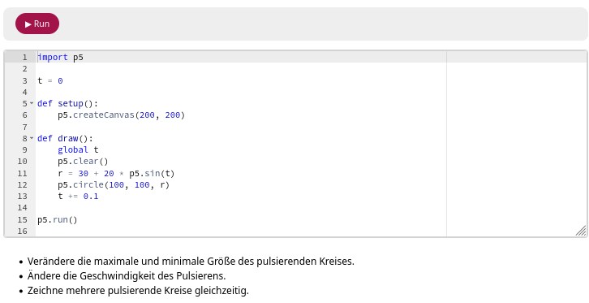
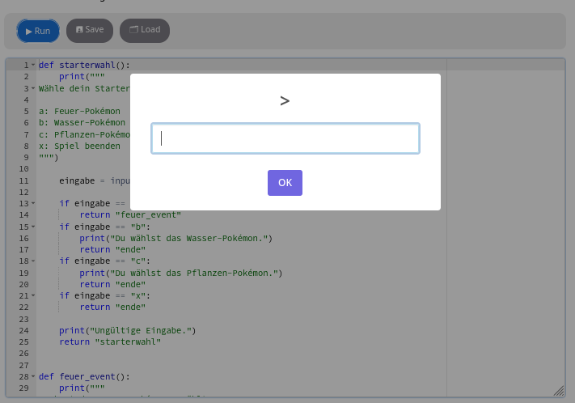
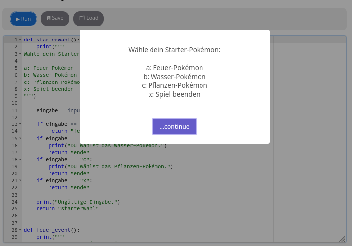
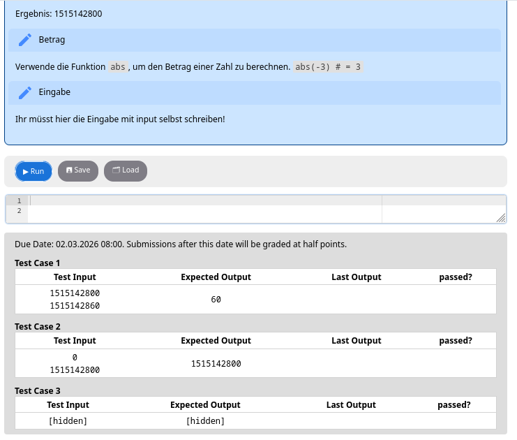
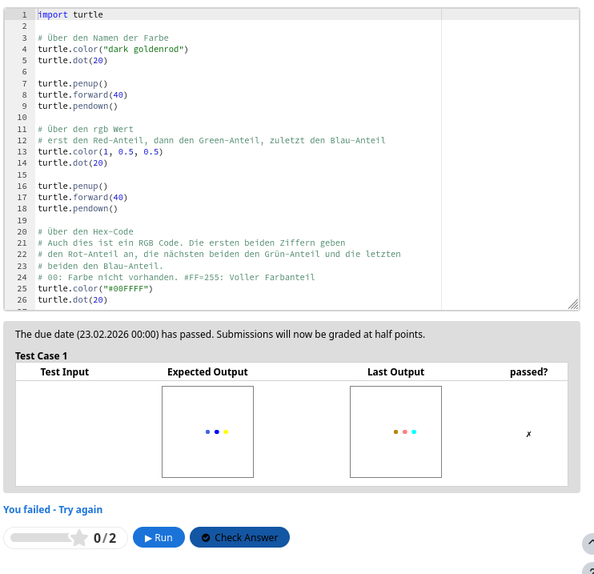

# H5P Python Question Type

A custom H5P content type that provides an interactive Python programming environment for learning and assessment.  
It allows educators to create coding assignments, interactive explanations, and auto-graded exercises directly inside H5P.


## Features

- Interactive Python IDE inside H5P
- Markdown-based learning pages with embedded code editors
- Automatic validation using input/output test cases oder image-comparison
- Turtle graphics support and p5 graphics support
- Designed for programming education
- Player mode: run code (console, canvas, p5, turtle, ...) without showing an editor, optionally with a "Show code" button
- Browser-based execution (no server required)


## Use Cases

- Programming exercises for students
- Interactive Python tutorials
- Coding assignments with automatic grading
- Self-paced learning modules
- Demonstrations and live coding explanations


## How It Works

This content type integrates:

- **Skulpt** and **Pyodide** → Python execution in the browser
- **Codemirror-Editor** → code editing interface

Student code runs directly in the browser and can be validated using predefined test cases.

## Player Mode

Enable **Player mode** (Editor Settings → Options for the assignment editor, or the
Options of a *Code* content part) to use code only as a program to *play*. The editor is
hidden; learners press **Run** and see the output. With **Offer "Show code" button**
(default on) they can reveal the code, edit it and run it again; turn it off to keep the
code hidden. In player mode the save/load buttons, the file manager and Python Tutor
are removed because they would expose the code. For content parts, *Show Editor?* must stay
enabled (it switches between a static code block and a live editor).

## Hosted Skulpt Runtime

Skulpt is not bundled in this H5P library. By default it is loaded from the p5-capable Skulpt build maintained in `StriveMath/p5-python-web`:

- Default: `https://cdn.jsdelivr.net/gh/StriveMath/p5-python-web@0.0.15/lib/skulpt.min.js`
- Alternative CDN: `https://rawcdn.githack.com/StriveMath/p5-python-web/0.0.15/lib/skulpt.min.js`
- Official Skulpt without p5 fork changes: `https://cdn.jsdelivr.net/npm/skulpt@1.2.0/dist/skulpt.min.js`

The advanced `Skulpt Script URL` setting accepts either a base directory or a direct `skulpt.min.js` URL. The matching `skulpt-stdlib.js` file is loaded from the same directory.

`p5-python-web` also ships a combined `dist/p5-python-web.js`, but this H5P integration intentionally uses the separate `lib/skulpt.min.js` and `lib/skulpt-stdlib.js` files so the existing Skulpt loader and runtime setup stay in control.

## External files and self-hosting

By default the content type loads its runtimes from public servers, so learners'
browsers contact them: `cdn.jsdelivr.net` (Skulpt, Pyodide and its packages,
Blockly, p5, Ruff, Pyrefly and UI libraries), `esm.sh` (Markdown, Mermaid),
`media.githubusercontent.com` (Pyrefly), and, for some Pyodide packages,
`pypi.org` and `files.pythonhosted.org`.

To serve these files yourself, set **External Library URLs (YAML)** on a task,
or define the same keys once for the whole site:

```html
<script>
  window.H5PPythonQuestionLibraryUrls = {
    skulpt: 'https://school.example/vendor/skulpt/skulpt.min.js',
    pyodide: 'https://school.example/vendor/pyodide/pyodide.js',
  };
</script>
```

The script has to run inside the frame that runs H5P, before the content is
created. How to add it depends on the platform (for example the
`h5p_alter_scripts` hooks). A setting on a task wins over the site-wide value.

Not covered by these keys: the `pypi.org` lookups for the Miniworlds packages and
the default `tkinter-web-backend` wheel. Mermaid diagrams in the task
instructions still use the default URL.

## Examples:


### Interactive Examples

See: [Showcase](https://www.opencoding.de/course/view.php?id=2) (german only)

### p5 Graphics




### Input and output vs popups





### Input/Output Testcases



### Image Comparison Testcases with turtle graphics



## Task assistant and test feedback

The H5P editor starts with a **Task assistant**. Preview a console, function,
OOP or turtle example before replacing the assignment instructions, starting code
and grading settings. Existing learning pages and global runtime URLs are kept.
The example tasks are written in German and can be edited freely.

**Check task and reference solution** checks missing tests, invalid JSON,
contradictory inheritance rules and test weights. For single-file Pyodide
input/output and function tasks without graphics, custom packages or fixed
pre/post code, it also runs the reference solution against the configured tests
in a separate worker. Function checks include the configured algorithm constraints.
Unsupported tasks receive an explicit message to check the content preview.
The check never executes or replaces learner work.

Input/output and function tests accept a **test name**, **learning goal**,
**hint after failure** and **points**. Visible tests are summarized by learning
goal. Hidden names and hints are not displayed. Output differences are marked,
with `·`, `⇥` and `↵` indicating spaces, tabs and line breaks.

Enable **Award partial credit** to award each passed test its configured integer
points (1–100, default 1). The maximum score becomes the sum of test weights.
Existing tasks retain the previous all-tests-must-pass scoring by default.

## Isolated console execution

Enable **Advanced Runtime Options → Run console tasks in a worker** with
**Pyodide** for console and function tasks. Execution runs in a fresh
worker for every run/test, keeping the page responsive and allowing Stop to
terminate execution. The configured execution limit starts after Python and
packages finish loading; time spent answering input dialogs is excluded. A
10-second limit applies when no limit is configured. Loading has a separate
120-second timeout, and output is limited to 1 MB per run.

Multi-file projects, pre/post code and custom package wheel URLs run in the
worker too: the additional project files are written into the worker's Python
file system below `/tmp/h5p_project/src` (which is put on `sys.path`) and
package names with a configured wheel URL are loaded from that URL. Only
graphics tasks — turtle, p5, pygame/miniworlds, tkinter/guizero, matplotlib —
retain the regular runtime, because a worker has no DOM canvas. Browser APIs
such as `js`/DOM access are unavailable inside a worker. Hosting CSP must permit
`worker-src blob:` and loading the configured Pyodide module (`pyodide.mjs`) and
its assets. A loading failure is reported; execution is not silently retried on
the main thread.

After production builds, run `npm run test:browser:isolated-execution` for a
server-free Chromium smoke test covering input, timeout, responsiveness,
cancellation, fresh state, function-test sequencing and the author's OOP check.

## Curated package sets

**Pyodide Advanced Options → Package set** selects a curated set
(`basic` numpy, `data` numpy+pandas, `science` numpy+scipy+sympy,
`graphics` numpy+pillow+matplotlib, `games` pygame-ce+miniworlds) that is
loaded in addition to individually selected packages. Set packages go through
the same normalization as explicit ones, so package loading, worker
eligibility, Blockly package blocks, precache and idle preload treat them
equally. Versions are pinned by the bundled Pyodide release's
`pyodide-lock.json` and by the pinned wheel URLs for PyPI packages
(miniworlds family, GUI backends), so a set only changes together with a
library release.

## xAPI reporting per test case

Besides the attempt-level `attempted`/`answered`/`completed` statements, every
graded test case sends one `interacted` statement whose object is a sub-activity
`<activity-id>#testcase-N` with the test case index, weight and pass/fail
result. Hidden test cases never expose their name, learning goal or expected
output. The per-test results are also persisted via `getCurrentState()`
(`previousState.testResults`) and restored on the next page load, alongside the
editor workspace.
